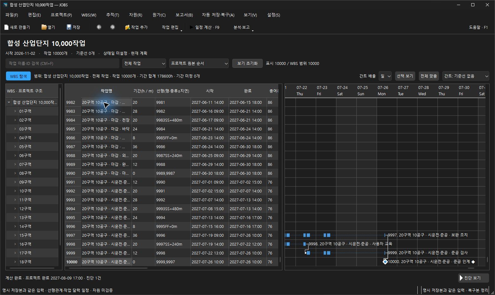
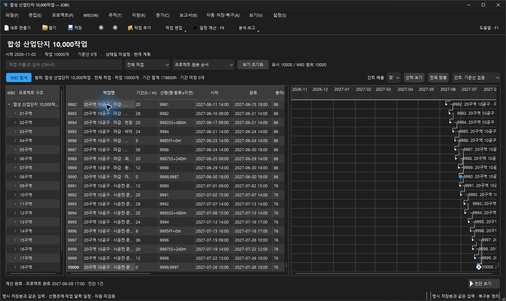

# 편집·간트·입력 화면·P6 호환성 검증

2026-10-30. 제품 소스 `97045d1cd19883f647175745c93d4b703fd81051`. 구현 전에 PRD POLISH-01~09와 [개선 계약](../../editing-polish.md)을 보완했다. 아래 결과는 배포 전 preview의 검증 범위이며 파일 schema9와 일정 정책은 유지한다.

## 적용한 변경

- macOS 스타일의 layout inset을 제외해 검색 줄의 실제 상단과 높이를 맞췄다. `WA_LayoutUsesWidgetRect`와 공통 높이를 사용하며 정렬 허용 오차는 늘리지 않았다.
- 작은 화면에서는 제목·중복 요약을 접고 진단 버튼을 보기 줄에 배치한다. 실제 화면의 가용 높이를 포함해 모드를 결정하고 모드가 바뀔 때만 배치를 변경한다. 큰 창에서는 원래 배치를 복원한다.
- 간트의 작업/기준선 ID 인덱스를 재사용하고 화면 주변 행만 그린다. 문서 snapshot은 weak identity로만 기억하고 독립 PlanInput을 보관해 다음 편집의 COW 복사를 강제하지 않는다. 입력 revision·계산 generation·표시 행/문서 교체를 구분한다.
- 작업 선택 시 화면 밖 날짜로 이동하며 **선택 보기 Ctrl+Shift+J**, **전체 맞춤 Ctrl+Shift+F**를 제공한다. 필터/WBS에 표시된 작업과 해당 기준선 날짜를 맞춘다. 확대된 날짜축은 일/주, 축소된 축은 월/분기/연을 사용하고 실제 글자 폭으로 겹침을 피한다.
- 제약·공수·자원·실적·원가·달력 편집기에 공통 높이/간격, label buddy, 작은 창 스크롤을 적용했다. 오류 시 초안·수정 포커스를 유지하고 오류 안내를 화면 안으로 스크롤한다. 버튼 글자 폭도 확보한다.
- 공개 P6 자료의 생략된 꼬리 NULL 필드·대소문자가 섞인 선택 필드·메모 DEL 줄바꿈을 진단과 원본 보존 하에 처리한다. 필수 값·초과 필드·다른 제어문자·전체 셀 예산 검증은 유지한다.

## 1만 작업의 측정

Windows 11 / Qt 6.8.3 / MinGW 13.1 Release / native windows / DPR1. 입력은 이전과 동일한 합성 10,000작업 XER이며 SHA-256은 `8f6236ad4f6c90b6e35f47179ac451f05ced3cc913f72c31f8ae235abc19ee6c`다. 실제 고객 자료가 아니다. 버전마다 별도 프로세스 3개를 순차 측정했다. OS 캐시를 비우거나 순서를 무작위화한 실험은 아니며 외부 UI 도구의 지연이나 FPS를 측정하지 않는다.

[변경 전후 요약](performance-comparison.json), [변경 전 원시 표본](performance/before/1.json), [최종 원시 표본](performance/after/1.json)과 각 실행의 binary/input hash 및 dirty provenance를 보존한다. 변경 전 HEAD는 PRD-only 커밋 `7c0125f`지만 제품 실행 파일은 `ab251153`과 동일하다. 이후 기준 측정의 dirty 표시는 당시 편집 중이던 소스를 뜻하며 세 번 모두 동일한 기존 binary hash를 사용했다.

| 항목 | 변경 전 | 최종 |
|---|---:|---:|
| F9 계산·GUI 반영, 세 프로세스 중앙값 | 5,936ms | 3,986ms |
| 계산·첫 표시 heartbeat의 프로세스별 최대 | 4,951–5,070ms | 210–347ms |
| F9 준비 / worker / GUI commit | 종전 분리 계측 없음 | 16–29 / 3,346–3,789 / 157–176ms |
| 선택·이동·repaint 96표본 p50 / p95 / max | 36 / 52 / 54ms | 50 / 69 / 80ms |
| 세로 스크롤·repaint 96표본 p50 / p95 / max | 31 / 41 / 64ms | 43 / 57 / 75ms |

긴 GUI 정지는 줄었지만 반복 선택·스크롤은 일부 느려졌다. 날짜 자동 이동으로 선택 시 그리는 가로 범위가 달라졌고, NoIndex는 deferred scene index 비용과 반복 조회 비용 사이의 절충이다. 모든 수치가 개선됐거나 모든 PC에서 같은 지연을 보장한다고 해석하지 않는다. 중간 반응형 배치의 반복 무효화가 만든 [지연 회귀](intermediate-layout-regression/1.json)도 보존했으며 최종 모드 캐시로 이를 제거했다.

[1만 작업·기준선 0개](performance/cell-edits/10000-0.json)와 [3개](performance/cell-edits/10000-3.json)의 셀 편집은 UI commit/events 표본과 undo 100단계·32MiB 예산을 확인한다. [요청/worker/commit 분리 표본](performance/responsive-edits/10000-3.json)은 비동기 편집의 별도 계측이며 F9 숫자와 합산하지 않는다.

## 화면 검증

Windows/macOS 각각 100/125/150/200% × 세 창 크기를 검사했다. 검색 줄은 실제 y좌표가 정확히 같고, 헤더44·행28·표/간트 viewport 정렬과 최소 네 줄을 유지한다. macOS 200%의 실제 높이 약328에서도 압축 배치를 사용한다. Windows 설정은 변경하지 않았다. [Windows 치수](windows/workspace/results.json), [macOS 치수](macos/workspace/results.json), [macOS 작은 화면](macos/workspace/2/layout.png)을 보존한다.

각 배율에서 주요 편집기 7개를 실제 밝은/어두운 앱 팔레트로 열어 높이·레이블·탭 이동·초안/오류 포커스/오류 가시성을 검사했다. 100/200% 대표 화면과 모든 배율 로그는 `windows/editors`, `macos/editors`에 있다. 나머지 캡처는 해당 CI artifact에 보존한다. 네이티브 검사는 다른 UI 계측과 직렬로 실행했다.

실제 새 payload 앱에서 이전 XER 변환 사본을 별도 파일로 열고 F9 계산, 마지막 작업 이동, 전체 맞춤과 필터/WBS 탐색을 확인했다. 완료일은 **2027-08-09 17:00**이다. [실제 앱/파일 hash](live-app.json)를 보존한다. 사용자 문서에 입력 변경을 하지 않았고 기존 사용자 앱은 보존했다.

[현재 열어 둔 주 단위 화면](live-final.jpg), [WBS/마일스톤 필터](live-filtered.jpg), [macOS 1만 작업 native 표본](macos/large-xer/result.json)도 보존한다.




## 공개 P6 corpus

[출처·라이선스·리비전·checksum](../../../tests/fixtures/p6-public/README.md), [7개 licensed 표본 행렬](p6-public/matrix.json), [2개 외부 표본 행렬](p6-external/matrix.json)을 보존한다. MPXJ 16.10.0 / JPype 1.6.0으로 원본을 독립 해석했다. 원본 작업 ID·관계 타입/지연·배정/자원 수를 대조하고, JOBS 수용 자료는 계획 기간·유효 주간 달력·독립 exported projection 및 JOBS 계산 날짜 왕복을 확인했다.

5개는 가져오기·계산·지원 부분 왕복을 통과했다. 4개는 `ASSIGNMENT_INPUT_INVALID`(다중 단가/역할 배정), `FILE_PRIMAVERAXER_028`(달력), `CURRENCY_UNSUPPORTED`(2개)의 명시적 최초 사유로 거부됐다. 통화 거부 이후의 다른 투영 가능성을 검증했다고 주장하지 않는다. 독립 MPXJ는 9개 모두 읽었다. 실제/잔여 기간과 JOBS 계획 기간의 차이는 행렬에 남겼다. SF/SS/FF/FS·음수 지연·휴일/마일스톤의 기존 golden 독립 검사도 유지한다.

외부 2개는 라이선스 미선언으로 raw bytes를 vendoring/배포하지 않고 ignored build에서만 검사했다. 업스트림 자료와 P6 헤더는 출처 근거이며 실제 고객 프로젝트 또는 Oracle 실행을 독립적으로 확인한 근거가 아니다. **Oracle P6 재계산/재저장 동등성은 미검증**이다.

## 회귀·배포

[최종 CTest](local-ctest.log), [Release 빌드](local-build.log), [clang-format18.1.8 검사](format.json), [아이콘 리소스](native-icons.json)를 보존한다. [전체 76개 생산 TU의 정적 분석](static-analysis/tidy.json), [ASan/UBSan CTest 54개](parser-safety/ctest.log), [실제 파서 instrumentation](parser-safety/instrumentation.json), [퍼징 실행 기록](parser-safety/parser-fuzz/run.json)도 보존한다. native fit probe는 1만 작업의 전체 맞춤, viewport 범위와 revision/dirty 보존을 시간 측정 이후 별도로 검사하며 `.fit.png`도 남긴다.

- [Desktop build and file lifecycle](https://github.com/jhoon-dev/JOBS/actions/runs/41022222221): completed / success
- [C++ format and static analysis](https://github.com/jhoon-dev/JOBS/actions/runs/41022222229): completed / success
- [Parser fuzzing and runtime checks](https://github.com/jhoon-dev/JOBS/actions/runs/41022222257): completed / success
- [MSIX package and installed lifecycle](https://github.com/jhoon-dev/JOBS/actions/runs/41022222259): completed / success

설치 파일은 `dist/JOBS-0.2.0-Setup-win64-97045d1c.exe`이며 13,518,073 bytes, SHA-256 `34c99b82051462b746e8e9e851b235eb32bc0647c93adc4bc31aad9e4feb0dea`다. 같은 0.2.0의 미서명 preview로 생성했으며 정식 Release/Store 게시를 하지 않았다. 로컬에서는 payload 실행과 설치기 생성·hash/아이콘을 검증했고 설치/제거 수명주기는 별도 CI에서 검증한다. 사용자 PC에서 설치·제거를 새로 실행하지 않았다.

## 재현

Qt DLL과 compiler bin을 PATH에 둔 Release 빌드에서 실행한다. 아래 출력 폴더는 새 이름을 사용해야 한다.

```powershell
ctest --test-dir build --output-on-failure
python scripts/check-workspace-scaling.py --build-dir build
python scripts/check-editing-polish-native.py --build-dir build
python scripts/make-xer-performance-fixture.py --tasks 10000 --output build/xer-reproduce
python scripts/run-large-xer-ui-probe.py --build-dir build --input build/xer-reproduce/industrial-campus-10000.xer --output build/xer-reproduce/result.json
python -m pip install mpxj==16.10.0 JPype1==1.6.0
python scripts/verify-p6-corpus.py --build-dir build --corpus tests/fixtures/p6-public --output build/p6-reproduce
python scripts/fetch-p6-external-samples.py --output build/p6-external-reproduce
python scripts/verify-p6-corpus.py --build-dir build --corpus build/p6-external-reproduce --output build/p6-external-compare
```
