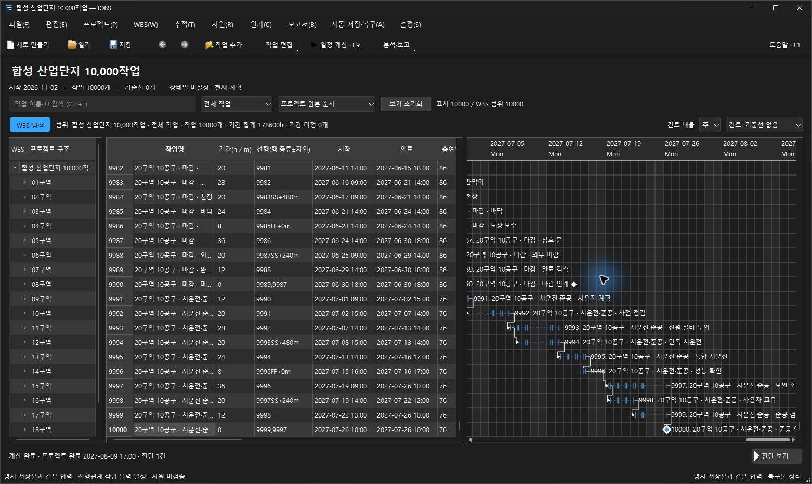

# 1만 작업 XER·아이콘·화면 높이 검증

2026-10-30. SCALEUI-01~05는 `c84b211`, 연결/배정 상한 SCALEUI-06은 `818d35f`에서 구현 전에 확정했다. [화면·계측 계약](../../large-xer-ui.md)을 따른다. 배포 소스는 `ab2511537441cf2094c823d80aaac6299a3d592a`, 마지막 제품 변경은 `aec2899`이다. 이후 변경은 네이티브 스타일의 1px 광학 여백 검사와 설명뿐이다.

실제 Windows 앱에서 UTF-8 XER 변환 확인을 거쳐 원본/진단을 보존한 사본을 열고 F9로 10,000개 작업을 계산했다. 첫 작업, 중간 5,393번 작업과 마지막 10,000번 작업 선택, 표·간트의 세로 동기화, 일/주 배율과 가로 이동을 확인했다. 최종 앱에는 마지막 작업을 선택하고 2027년 7~8월 간트를 표시했다. 완료일은 **2027-08-09 17:00**이다. 최종 실행 파일과 설치 payload의 SHA-256 일치도 확인했다([기계 판독 요약](verification.json)).



## 입력과 수용 범위

[재현 가능한 합성 자료 명세](fixture.json): 작업 10,000개, 프로젝트 루트 외 WBS 1,220개, 마일스톤 1,000개, FS/SS/FF 관계 10,999개, 달력 3개, 자원 50개, 배정 12,000개다. 원본은 1,906,375 bytes이고 SHA-256은 `8f6236ad4f6c90b6e35f47179ac451f05ced3cc913f72c31f8ae235abc19ee6c`이다. 실제 고객 데이터가 아니며 P6 독립 재계산 일치나 자원 가용량 충족을 입증한 결과가 아니다.

처음 가져오기에서 작업별 여러 관계/배정에도 활동과 같은 10,000행 제한이 적용되는 문제를 발견했다. TASK는 10,000, TASKPRED/TASKRSRC는 각각 100,000행으로 구분했다. 파일 16MiB·총 행/셀/문자 예산과 참조·중복 검증은 유지했다. `primavera_xer_contract`는 1만 활동과 다중 관계/배정 왕복, 각 테이블 상한 초과와 전체 행 예산 초과 거부를 검사한다.

## 성능

Windows 11, Qt 6.8.3, MinGW 13.1 Release, native windows 플랫폼, DPR 1. 실제 importer·Document·MainWindow를 사용하는 독립 Qt 계측 프로그램의 결과다. 외부 데스크톱 도구의 요청 지연은 포함하지 않는다. [최종 원시 표본](performance-final.json)과 [소스·실행 파일·입력 provenance](performance-final.provenance.json)를 보존한다.

| 단계 | 최종 로컬 측정 |
| --- | ---: |
| 원본 읽기·해석 | 451ms |
| 원본/진단/사본 게시 | 1,091ms |
| 문서 열기 | 373ms |
| 창 구성 / 첫 표시 | 197ms / 363ms |
| F9 계산·GUI 반영 | 3,929ms |
| 계산 후 명시적 viewport repaint | 41ms |
| 작업 선택·중앙 이동·repaint 32회 | p50 41ms / p95 63ms / max 63ms |
| 세로 스크롤·repaint 32회 | p50 36ms / p95 54ms / max 56ms |
| 계산·첫 repaint의 이벤트 루프 간격 | p50 15ms / p95 18ms / max 180ms |

선택된 ID의 간트 강조와 표/간트 스크롤 값 일치, 마지막 행까지 검사했다. 관찰한 scene item 최댓값은 186개다. 이 결과는 전체 화면에 1만 개를 동시에 그렸다는 뜻이 아니다. 주변 행을 표시하는 가상화를 이용한다.

[첫 계측](performance-first.json)은 계산·반영 8.42초, 계산 후 repaint 1.61초, 선택 최댓값 1.93초였다. 이후 [헤더 수정 전](performance-pre-header.json), [불투명 배경 수정 전](performance-pre-opacity.json), 최종 표본을 모두 남겼다. 실행 시 부하와 캐시 상태를 통제한 A/B 실험이 아니므로 수치 차이를 최적화 효과나 모든 PC에서의 즉시 반응으로 주장하지 않는다. 최초 표시·일부 선택의 긴 지연은 추가 추적 대상이다. 32개 위치의 유한 표본을 지속적인 입력의 FPS나 입력-to-present 지연으로 환산하지 않는다.

## 아이콘과 화면 크기

Store의 기존 간트 SVG를 공통 원본으로 PNG·ICO·ICNS를 생성했다. Qt resource/앱/창, Windows EXE, macOS bundle, NSIS 설치/제거기에 연결했다. [생성 checksum](icons.json), [실제 PE 아이콘 리소스 검사](native-icon-resources.json)와 [검사 스크립트](verify-native-icons.py)를 보존한다. EXE #101과 설치기 #103에 각각 10개 크기가 들어 있다. macOS 실제 bundle 아이콘의 시각 확인은 로컬 Windows 결과로 대신하지 않는다.

검색/필터/정렬/초기화 및 WBS·배율·기준선/진단, 기본 도구 버튼은 같은 폰트 기반 높이를 사용한다. WBS/표/간트 헤더는 44, 행은 28 논리 픽셀이며 하단 스크롤 영역을 맞췄다. 일반 대화상자에 영향을 주던 전역 콤보박스 스타일은 작업 영역으로 제한했다.

최종 [배율 검사](scaling.json)는 100/125/150/200% × 요청 창 크기 1024×650·1280×720·1440×900의 12개 조합에서 통과했다. 실제 창은 화면의 작업 가능 영역에 맞춰 작아질 수 있으며, 실제 치수와 DPR은 각 `scaling/*/geometry.json`에 기록했다. Windows 설정은 바꾸지 않았다. [작은 창](layout-1024.png)과 [일반 창](layout-1440.png)은 앱 자체 Qt widget 캡처다.

혼합 스크롤 중 작업명이 고정 날짜 헤더에 비치는 문제도 확인했다. 전체 viewport 갱신으로 고정 헤더의 스크롤 복사를 막고, 반투명 AlternateBase 아래에 불투명 Base를 그려 작업을 가렸다. [네이티브 회귀](header-native.log)는 작은 세로 이동·가로 이동의 헤더 repaint와 반투명 팔레트에서 magenta scene underlay 전후의 헤더 이미지 일치를 검사한다. 실제 앱에서도 작은 스크롤 후 가로 이동을 재현해 겹침 해소를 확인했다.

## 회귀와 CI

- 마지막 제품 변경의 [전체 CTest 52개](local-ctest.log)가 87.72초에 통과했다. 이후 테스트 여백 조건만 바꾼 최종 소스의 [presentation 재검사](presentation-final.log)도 통과했다. [Qt Test 상세](presentation-ctest.log)는 초기화/종료 포함 9개 통과다.
- [고정 포맷 검사](format.json)가 통과했다. 파일 schema9, 일정 정책, 저장 안전성, 취소, 기존 편집 흐름은 유지한다.
- 이전 UI 캡처 CI의 고정 500px/창 절반 조건은 플랫폼의 실제 작업 영역을 반영하지 못했다. 최소 4개 작업 행과 표·간트의 실제 높이/헤더 정렬을 검증하고, 캡처를 검사 전에 저장하도록 바꿨다. 네이티브 macOS 검색 줄의 같은 높이 컨트롤에는 1px 광학 여백만 허용한다.
- 최종 Windows/macOS·정적 분석·파서/sanitizer·MSIX CI는 작성 시 실행 중이다([스냅샷](ci-snapshot.json)). 이전 중간 소스 `311de53`의 MSIX/설치 수명주기는 통과했지만 이를 최종 전체 CI 통과로 확대하지 않는다.

## 설치와 재현

`dist/JOBS-0.2.0-Setup-win64-ab251153.exe`: 13,509,813 bytes, SHA-256 `f5089bee8d853fa46251bd1a8c6a1a2fe6cb232240772d1c2d8669ec0688242f`. [설치기 메타데이터](installer.json)를 보존한다. 같은 0.2.0의 미서명 preview이며 정식 Release/Store 제출은 하지 않았다. 이 로컬 결과는 설치기 생성과 아이콘 리소스 검사이고 사용자 PC에서 설치·제거를 새로 실행한 결과가 아니다.

새 폴더 이름을 지정해 자료와 계측을 재현한다. 기존 결과 폴더는 덮어쓰지 않는다.

```powershell
python scripts/make-xer-performance-fixture.py --tasks 10000 --output build/large-xer-new
python scripts/run-large-xer-ui-probe.py --build-dir build --input build/large-xer-new/industrial-campus-10000.xer --output build/large-xer-new/result.json
```

실제 앱에서는 **파일 → Primavera XER 가져오기 → UTF-8 → 새 사본 열기 → F9**로 확인한다. 마지막 행은 작업 셀을 선택한 뒤 Ctrl+End, Home으로 이동하고 간트의 주 배율과 가로 스크롤로 해당 날짜를 확인한다.
