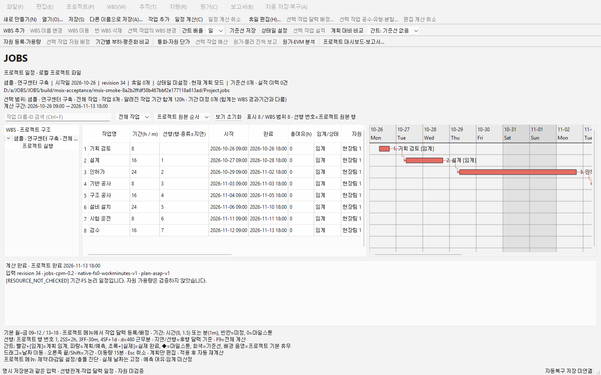

# MSIX·Store 제출 준비 검증

2026-10-29. 요구사항 MSIX-01~06은 `308c664`에서 먼저 확정하고 구현했다. 제품/패키지 검증 대상은 `4c3ae444d1d92f75720835e42d2066891a963c80`이다. 이후 `28e6770`은 제출 자료에 규격을 만족하는 화면만 선택하는 도구/문서 변경이며 제품 C++·CMake·패키지 내용은 바꾸지 않았다.

## 전달 파일

사용자에게 전달하는 `dist/msix/JOBS-development-1.0.0.0-x64-4c3ae444-ci.msix`는 CI의 일반 개발 패키지 그대로다. 파일명에 `-ci`만 덧붙였고 archive bytes는 같다. 25,800,106 bytes, SHA-256 `fef9b7301e26609792d32efa6c05dbfbe5d8ce345719e165d1a96e701f1201f6`. [메타데이터](delivered-package.json)에 전체 payload·SHA·SDK 도구·공급자 archive checksum과 출처를 보존한다.

일반 개발 패키지는 테스트 probe가 없다. 설치 수용 검사는 같은 빌드의 probe 포함 버전 1.0.0.0과 1.0.1.0으로 수행했다. 일반 패키지의 `JOBS.exe` SHA `fd3913bfbcac8e2c7bb1be8990ec02b68c168b1aaeafc79bcb2368731a6c7ee9`가 설치 검사에 사용한 production entry point의 앱과 같은지 대조했다. UI/계산 검증 probe는 같은 라이브러리 빌드에 연결한다. 일반 패키지도 MakeAppx와 독립 ZIP/manifest/전 파일 SHA 검사를 통과했다.

로컬 MinGW Release에서도 별도로 18,024,768-byte MSIX를 만들고 검사했다. 로컬 빌드와 CI 빌드는 같은 소스이지만 바이너리/패키지 bytes가 다르다. [로컬 메타데이터](local-package.json)와 CI 전달물의 해시를 구분하며 빌드 간 bit 동일성을 주장하지 않는다. 기존 NSIS 생성기도 공유 payload 변경 후 정상적으로 설치기를 생성했다. 이번 NSIS 검사 범위는 생성 회귀이며 재설치/클릭 검증은 아니다.

`dist/msix/store-preparation.zip`에는 소개문·개인정보 처리방침·ID 서식·아이콘·체크리스트·실제 화면·개발용 검증 결과가 있다. SHA-256 `056aa2954221f7548e09ccd4cd3074593ad326185d0f8aee18b944e90d863305`. 실제 Store ID/최종 제출용 MSIX는 아직 없으며 제출 자료 묶음에 개발 패키지를 심사용 파일로 끼워 넣지 않았다.

## 설치·업데이트·복구·제거

[MSIX CI](https://github.com/jhoon-dev/JOBS/actions/runs/40797592680)는 성공했다. [실제 실행 결과](lifecycle.json)에 Windows build 26100과 `ToolMoa.JOBS.MsixDevelopment_ndcysebgwkhs8` identity를 기록했다.

- production `JOBS` application entry point를 활성화해 실제 창을 열고 정상 종료했다.
- package identity 아래에서 생성/저장/열기·일정 계산·undo·공유 작업 영역을 검사했다. 설치 폴더 쓰기는 거부됐다.
- 설정과 checkpoint가 package LocalState에 저장되는지 확인했다. 1.0.1.0으로 올린 뒤 설정을 읽고 미저장 checkpoint를 복구했다.
- 제거 후 설정/복구가 사라지고 외부 `.jobs`/`.jobsworkspace` 및 EXE판 상태 sentinel의 해시가 유지됨을 확인했다.
- 인증서·신뢰 저장소·개발자 모드/보안 정책을 바꾸지 않았다. 로컬 비관리자 환경에서 패키지 설치를 시도하지 않고 관리자 Windows CI의 공식 unsigned 개발 경로를 사용했다.

GitHub artifact 12863724746의 공급자 SHA-256과 내려받은 ZIP을 대조하고 24개 추출 파일을 재검증했다([기록](msix-artifact.json)). [MakeAppx 로컬 로그](makeappx-local.log)와 manifest/파일 목록을 보관한다. OPC part name의 `%2B` 이스케이프를 디코딩해 MinGW `libstdc++-6.dll`도 검사하며, 이스케이프 경로 우회/중복 alias는 거부한다.

## 회귀·품질

- 로컬 MinGW Release [50개 CTest](local-ctest.log) 모두 통과(159.58초). 새 검사는 일반 EXE 저장 경로 불변과 MSIX UI probe의 비패키지 계약이다.
- Python [packaging 계약 7개](packaging-contracts.log) 통과. ID 누락/placeholder/개발 OID/알 수 없는 필드, 버전 범위/네 번째 자리, XML escape, 자산 hash, 금지 파일, payload/ZIP 변조·경로·중복을 검사했다. [빈 ID 서식의 Store 생성](empty-store-identity.log)도 실패하는 것을 실제 명령으로 확인했다.
- [고정 포맷](local-format.json) 통과. [정적 분석](tidy.json)은 Clang 18의 제품 TU 68개 모두 성공([CI](https://github.com/jhoon-dev/JOBS/actions/runs/40797592946), [artifact](quality-artifact.json)).
- Linux ASan/UBSan [50개 CTest](asan-ctest.log) 모두 통과(194.54초). `.jobs`/XML/XER/작업 영역 파서마다 seed replay와 5,000회, 총 20,000회 유한 퍼징을 통과했다([명령과 종료 코드](fuzz-run.json), [CI](https://github.com/jhoon-dev/JOBS/actions/runs/40797592857), [artifact](parser-artifact.json)). 제한된 smoke 검사이며 전체 입력의 보안·호환성을 보증하는 것은 아니다.
- Windows MSVC 50개(89.62초)/macOS 50개(76.57초) CTest와 전체 desktop workflow가 성공했다([CI](https://github.com/jhoon-dev/JOBS/actions/runs/40797592682), [단계·종료 상태](desktop-ci.json), [검사 출력](desktop-checks.log)). XLSX/PDF/XML과 XER의 독립 TSV/MPXJ reader, 기존 native 편집/취소·구조 변경 검사를 유지했다.
- Windows/macOS의 1천/1만 작업 legacy/effort 일정 hash 8개가 이전 `a2039fed`의 기록과 모두 같았다. [Windows 측정](Windows/), [macOS 측정](macOS/)과 [기계 판독 요약](verification.json)에 원본 샘플·소스 ID·비교 결과를 보관한다. 플랫폼별 checkout byte hash는 다를 수 있으며 공통 식별자는 Git revision이다. 이번 변경을 계산 정책이나 UI 성능 변경으로 해석하지 않는다.

[4개 CI 최종 상태](ci-runs.json)는 모두 성공이다. Store 계정/실제 ID 없이 수행할 수 있는 개발 패키지 준비와 수용 검사를 완료했다.

## 실제 화면과 남은 단계

이 화면은 패키지 probe에서 실제 Qt UI를 1440×900으로 캡처한 샘플 프로젝트다. Store 묶음은 이 화면을 그대로 사용한다. [공유 자원 화면](02-shared-resources.png)은 실제 대화상자 캡처지만 CI의 화면 크기 제한으로 1028×749이므로 검증 보조 자료로만 보존한다. 인위적 확대나 합성을 하지 않았다.

Partner Center 가입/이름 예약·실제 identity·가격/국가/등급·게시자 정보 확인, 실제 identity의 Store MSIX 재생성, WACK와 대상 기기 검증, 업로드/심사는 남아 있다. 개발 OID 패키지는 Windows 11 이상 관리자 테스트용이며 Store 제출용이 아니다. 최소 OS 19041 전체 기기 범위의 인증이나 Store 승인으로 확대하지 않는다. [제출 절차](../../store/submission-checklist.md)를 따른다.
