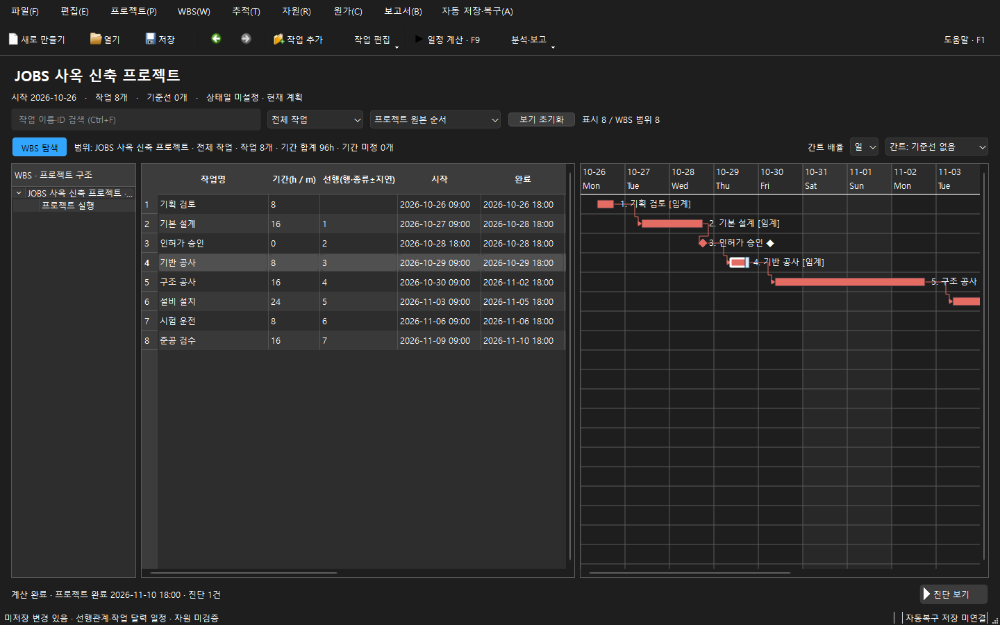
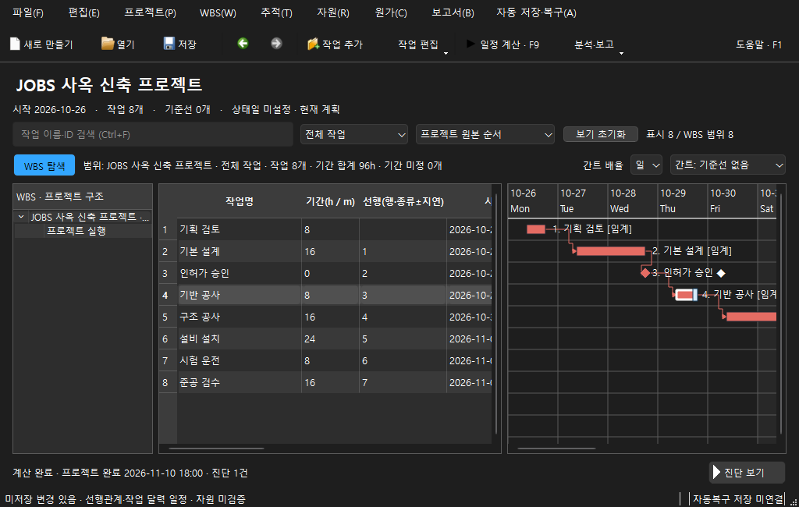

# 작업 표·간트 중심 UI 1차 개선

2026-10-29. 사용자 선택은 “작업 표·간트 중심으로 깔끔하게 정리”다. UX-01~05와 [화면 계약](../../workspace-ui.md)은 `0bca077`에서 구현 전에 확정했다. 최종 소스/설치기는 `585328e8fb6e3418f551ab438891ca53d9fc4e66`이다. 마지막 제품 C++ 변경은 `8c108d99`; 이후 커밋은 Qt의 지연된 toolbar layout을 검사하는 테스트와 테스트 출력 설정만 바꿨다.

기본 도구 모음을 한 줄로 모으고 기존 명령을 공유하는 작업 편집/분석 메뉴를 제공한다. 검색·필터·정렬 및 WBS 표시/간트 배율·기준선을 작업 영역 위에 배치했다. 프로젝트 제목/핵심 요약과 파일 상세를 구분하고, 표의 기본 열 폭과 간트 구분선을 조정했다. 진단과 설명을 접어 기본 작업 영역을 확보하며 시스템 팔레트를 유지한다. 문서 형식·일정 정책·비동기 편집/증분 갱신은 바꾸지 않았다.

## 검증

- 로컬 MinGW Release의 [CTests 52개](local-ctest.log)가 모두 통과했다(164.89초).
- [새 Qt Test 검사](presentation-ctest.log)는 초기화/종료를 포함해 7개 통과다. 1024×650의 작업 행/정렬된 표·간트 헤더, 빈 문서 진입, WBS 접기 후 범위/선택 유지, 공유 작업 메뉴, 새 문제 자동 표시와 사용자 접기 유지, 실제 계산/취소 과정의 명령·버튼 상태를 검사한다.
- 기존 공수 역산·일정 계산 취소, 필터/정렬/WBS의 원본 행·집계·증분 알림, 문서 저장·복구·undo·보고서·업데이트 회귀를 유지했다. 초기 검사에서 취소 QAction을 숨기면 명령이 비활성화되는 문제를 발견해 표시용 QWidgetAction과 실제 명령을 분리했다. 기능을 약화하거나 기존 회귀 테스트를 삭제하지 않았다.
- [고정 포맷 검사](format.json)가 통과했다. [실제 native 캡처](native-capture.log)는 앱 자신의 Qt widget을 그려 저장하며 데스크톱 입력이나 이미지 합성을 사용하지 않는다. Windows offscreen 테스트의 폰트/size-hint 경고는 native 캡처와 구분한다.
- Windows/macOS·정적 분석·sanitizer/파서·MSIX의 추가 CI는 이 기록 작성 시 실행 중이다([스냅샷](ci-snapshot.json)). 로컬 수용 결과를 전체 CI 완료로 확대하지 않는다.

## 설치 파일

`dist/JOBS-0.2.0-Setup-win64-585328e8.exe`: 13,077,183 bytes, SHA-256 `389cf87fd13d29de7b4db15b59ccfeaddf9ff84f86e1c4910fb510eb4ba4099b`.

[설치기 메타데이터](installer.json)와 [기계 판독 요약](verification.json)에 버전·소스·검사·checksum을 보존한다. 같은 0.2.0의 새 시험 빌드이며 정식 Release는 게시하지 않았다. 설치기는 미서명 preview다. 이번 기록은 설치 파일 생성이며 사용자 PC에서 설치기를 실행하거나 Store에 제출한 검증이 아니다.

## 실제 화면

1440×900, 시스템 다크 팔레트:

1024×650, 가로 스크롤과 splitter로 작업 영역 조절:

